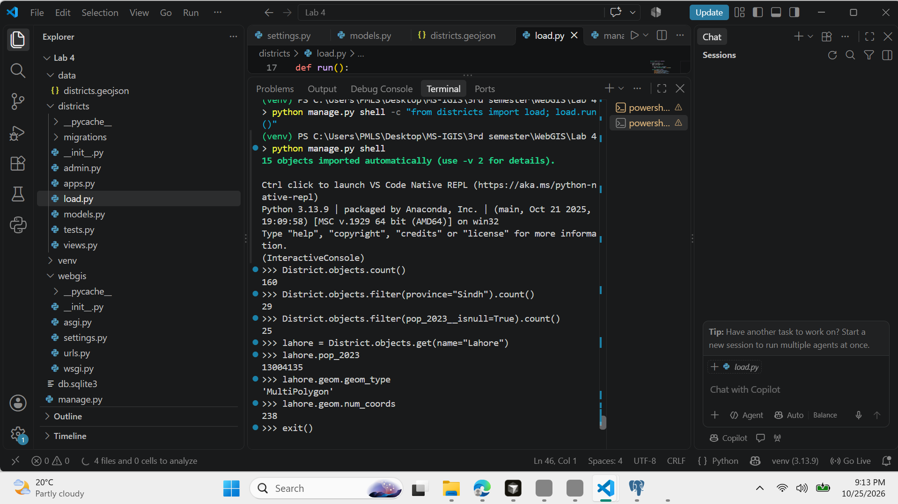
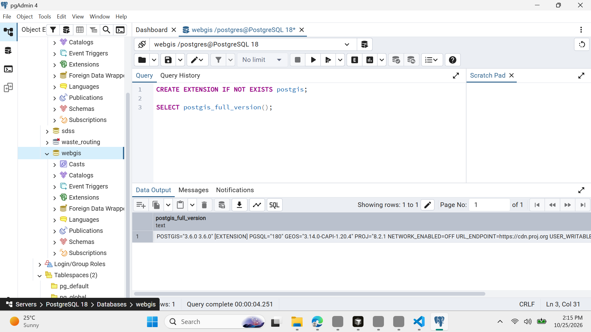

# Laboratory 5 — A Spatial API: Querying and Collecting Data with GeoDjango

**Project:** NUST MS Remote Sensing & GIS, Web GIS Lab 5  
**Workspace:** `Lab 5`  
**Evidence status:** Implementation work is in progress. Runtime evidence is included only when observed; entries marked pending require a live PostgreSQL/browser session.

## Implementation and audit

- The existing `District` model and GeoJSON serializer were retained. `DistrictViewSet` is read-only and uses `InBBoxFilter` plus `DjangoFilterBackend` for bbox and province filtering.
- The project environment reports Python 3.13.9, Django 6.1.2, Django REST Framework 3.18.3, django-filter 26.2, and djangorestframework-gis 1.3.0. This differs from the Python 3.14 version mentioned in the assignment brief.
- Added `Facility` with the requested point geometry, choice default, ordering and admin configuration; added a GeoFeature serializer, point-in-district validation, and a GET/POST-only viewset with bbox, kind and 25 km distance filters.
- Replaced the map’s one-time full-dataset load with abortable `moveend` bbox requests. Added visible response counts/KB, an in-page measurement table, safe popup text, CSRF-protected facility creation, and 25 km search mode.
- Existing `Screenshots/` images are genuine Lab 4 evidence and are preserved. The district-count image was reused for Checkpoint 1; no replacement images have been fabricated.
- The original 21-page Lab 5 PDF was available in the existing Edge tab and was checked for the model, serializer, filters, map behavior, experiments, questions and submission requirements.

## Checks completed in this environment

| Check | Result |
|---|---|
| `python manage.py check` | Passed: no issues |
| Facility migrations | Passed: `0001_initial` and `0002` generated and applied |
| PostgreSQL/PostGIS connection | Passed against configured local database `webgis` |
| Migration SQL / migrate / district count | Passed; the facilities table has `geometry(POINT,4326)` and a GiST index; district count remains 160 |
| API requests | Passed: root 200; district list 200/160 features; detail 200; Sindh filter 200/29; bbox filter 200/4 |
| Browser map and bbox measurement table | Passed live in browser; four measurements recorded below |
| POST/validation and distance API | Passed live through DRF API test client; results recorded below |
| Authenticated CSRF rejection | API client with CSRF checks returned 403; exact browser/admin-tab experiment pending |
| Popup click, malicious-name display, XSS-without-escaping experiment | Pending: computer-use session stopped before the popup could be opened reliably |
| Git checkout/remote/push | Pending: Lab 5 is not a Git checkout; the sibling checkout was inaccessible from this workspace sandbox |

### Environment package freeze

```text
asgiref==3.13.0
Django==6.1.2
django-filter==26.2
djangorestframework==3.18.3
djangorestframework-gis==1.3.0
psycopg==3.3.6
psycopg-binary==3.3.6
sqlparse==0.6.0
tzdata==2026.5
```

## Part 3 — dynamic loading measurements

The UI at `/` contains buttons that make each named request and record the returned feature count and uncompressed response-body size. The values below were read from the live browser measurement table.

| View | District count | Response size |
|---|---:|---:|
| Entire dataset | 160 | 913.0 KB |
| Islamabad, zoom 9 | 10 | 64.5 KB |
| Zoomed out, zoom 6 | 86 | 514.4 KB |
| Lahore, zoom 11 | 2 | 13.7 KB |

## Available Checkpoint 1 evidence



This is a copy of the existing genuine Lab 4 ORM screenshot showing 160 districts. A fresh `pip freeze` terminal screenshot is still required for `CP1_01_Pip_Freeze.png`.

## Part 5 — validation outcomes

The successful `IGIS, NUST` request returned **201 Created** and district `Islamabad`. The three invalid requests each returned **400 Bad Request**:

1. Sea point `[64.0, 23.0]`: `{"geom":["This point is not inside any district of Pakistan."]}`
2. Invalid kind `castle`: `{"kind":["\"castle\" is not a valid choice."]}`
3. Reversed coordinates `[33.6423, 72.9906]`: `{"geom":["This point is not inside any district of Pakistan."]}`

## Part 6 — experiment observations

1. **Sea point:** The API validation was exercised directly and returned 400 with `This point is not inside any district of Pakistan.` The map click experiment itself remains pending.
2. **Malicious-looking facility name with escaping enabled:** The API accepted and stored `` in a local test facility. The map has `escapeHtml()` in its popup, but the popup could not be opened reliably in the browser session, so browser execution/display was not claimed.
3. **Escaping disabled:** Not performed. No insecure code was left in the project. This requires opening the marker popup in the local browser; then temporarily remove the name escaping and restore it immediately after observation.
4. **CSRF after admin login:** The map POST includes `X-CSRFToken` and same-origin credentials. An authenticated API-client request with CSRF checks and no cookie/header returned `403 {"detail":"CSRF Failed: CSRF cookie not set."}` without creating a record. The PDF's specific browser test (admin login in another tab, then remove/restore the header) remains pending.

## Part 7 — distance search

`/api/facilities/?dist=25000&point=72.9906,33.6423` returned four features: the three starter facilities and the local XSS test name; all four are in Islamabad. A temporary facility at `[67.0011, 24.8607]` was accepted in South Karachi, then excluded from that same live distance query and removed after the check. The screenshot of the circle and result popup remains pending.

## Part 8 — questions

1. **Why does view-based loading save much at zoom 9 and little at zoom 6? What helps at country scale?** At zoom 9, a small viewport intersects far fewer district geometries than the full dataset, so fewer features and bytes are transferred. At zoom 6 the viewport covers much more of Pakistan, so a large fraction of districts still intersects it. At country scale, generalized geometries, vector tiles, clustering, or scale-dependent representations reduce payload and rendering work.
2. **One advantage and one cost of calculating a facility’s district each time:** It avoids storing a duplicate district value that could become stale if boundaries change. The cost is a spatial query whenever the district is needed, which adds database work and latency.
3. **Why validate on the server if the map discourages sea clicks?** Clients can be bypassed or modified, and requests can be sent without using the map. Server validation is the trusted boundary that protects stored data.
4. **Why did posting fail only after logging in to admin?** With session authentication, Django REST Framework enforces CSRF checks for authenticated session requests. The browser then sends the admin session cookie, so an unsafe request also needs a valid CSRF token. This explanation is consistent with the framework behavior; the requested live comparison remains unverified.
5. **What happens without `escapeHtml()`, and who is affected?** If untrusted names are interpreted as popup HTML, markup or script-capable event attributes can execute in the page. A real stored-XSS issue can affect any user who views that facility’s popup. The insecure experiment has not been run.
6. **What must exist before allowing DELETE?** An authorization and recovery design: restrict deletion to trusted users, prevent accidental removal (for example, confirmation or soft-delete), and keep an auditable backup/restore path. A public write API should not expose deletion without those safeguards.

## Outstanding evidence and release steps

The new `CP1_02_District_Count.png` is reused from genuine existing evidence. After the browser session is available again, capture: `CP1_01_Pip_Freeze.png`, `CP2_01_Individual_District_API.png`, `CP2_02_JSON_Network_Size.png`, `CP3_01_Measurement_Table.png`, `CP3_02_Map_InBBox_Network.png`, `CP4_01_Geometry_SQL_Index.png`, `CP4_02_Facilities_Admin.png`, `CP5_01_Successful_POST_201.png`, `CP5_02_Sea_Point_Error.png`, `CP5_03_Invalid_Kind_Error.png`, `CP5_04_Reversed_Coordinates_Error.png`, `CP6_01_Add_Facility_Form.png`, `CP6_02_Sea_Point_Validation.png`, `CP6_03_HTML_Escaping.png`, `CP6_04_XSS_Test_Without_Escaping.png`, `CP6_05_CSRF_Test.png`, and `CP7_BONUS_01_25km_Search.png`. Live database checks, district count, migrations, filters, all API validation payloads, distance results and the out-of-radius exclusion are complete. The sibling Git checkout is confirmed as clean with `origin` pointing to the requested GitHub repository; the Lab 5 submission copy, commit and push are still pending so browser-only work is not represented as completed.

---

# Previous Lab 4 report (preserved)

## Lab 4 report archive

**Web GIS — Districts from PostGIS**

**Interactive Map (Local):** [Open Districts from PostGIS](http://127.0.0.1:8001/)

**GeoJSON API (Local):** [View District Data](http://127.0.0.1:8001/api/districts/)

---

## Checkpoint 1 — Django Setup and Versions


The Django project `webgis` and application `districts` were successfully created and verified in a Python virtual environment.

## Checkpoint 2 — PostgreSQL and PostGIS



PostgreSQL 18 and PostGIS 3.6.0 were configured. A PostGIS-enabled database named `webgis` was prepared to store spatial district data.

## Checkpoint 3 — Django Database Configuration


Django successfully connected to PostgreSQL/PostGIS, and the initial database migrations were completed. GDAL and GEOS library compatibility was verified.

## Checkpoint 4 — District Spatial Model


The `District` model stores district names, provinces, population, area and `MultiPolygon` geometries in EPSG:4326.

The database migration successfully created the spatial table `districts_district` and a GiST index on the geometry field for efficient spatial queries.

## Checkpoint 5 — Loading the District Data


The Pakistan district GeoJSON dataset was successfully imported into PostgreSQL/PostGIS.

A total of **160 districts** were loaded. Django ORM queries were used to verify the imported records and retrieve district information.

## Checkpoint 6 — Django Admin


The `District` model was registered in Django Admin to support authorized management of geographic information.

The screenshots demonstrate district filtering, record inspection and editing through the Django administration interface.

## Checkpoint 7 — Django GeoJSON API and Leaflet Map


The interactive Leaflet map displays **160 districts** retrieved directly from PostgreSQL/PostGIS through the Django API, rather than from a local static GeoJSON file.

Districts are symbolized using province-specific colours, and hovering over a district displays its name and province.

The Esri World Topographic Map was used as the basemap after the original OpenStreetMap tile service returned an HTTP 403 access restriction.

### Network Verification

| Property | Observed Result |
|---|---|
| API endpoint | `/api/districts/` |
| Request method | GET |
| HTTP status | 200 OK |
| Content type | `application/geo+json` |
| Content-Length | 1,026,495 bytes (approximately 1.03 MB) |

*Note: Content-Length represents the response-body size, which may differ from the transferred size reported by the browser's Network panel.*

## Checkpoint 8 — PostGIS Spatial Query (Bonus)


A spatial query was implemented to identify the district containing a user-selected location.

When a user clicks the map, latitude and longitude are sent to `/api/where/`. GeoDjango creates a geographic point and uses the `geom__contains` spatial lookup to identify the corresponding district.

The endpoint was tested successfully through Django.

### Area Comparison

| District | Stored Area (km²) | Geodesic Area (km²) | Web Mercator Area (km²) |
|---|---:|---:|---:|
| Lahore | 1,730 | 1,730 | 2,385 |
| Gilgit | 4,016 | 4,015 | 6,133 |
| Gwadar | 11,574 | 11,574 | 14,244 |

### Interpretation

Web Mercator is primarily intended for web-map visualization rather than accurate area measurement. The results demonstrate that Web Mercator produces larger area estimates compared with the stored and geodesic areas.

Area distortion generally increases toward higher latitudes. Therefore, geodesic calculations or locally appropriate projected coordinate systems are more suitable for accurate district area measurements.

---

## Software Versions

| Software | Verified Version |
|---|---|
| Python | 3.13.9 |
| Django | 6.1.2 |
| PostgreSQL | 18 |
| PostGIS | 3.6.0 |
| GDAL | 3.13.3 |
| GEOS | 3.15.0-CAPI-1.21.0 |

---

## Installation and Configuration Errors

During the installation and configuration process, several errors were encountered and successfully resolved.

### Error 1 — Python Launcher Not Recognized

**Error encountered:**

`py : The term 'py' is not recognized as the name of a cmdlet, function, script file, or operable program.`

**Cause:** The Windows Python launcher was unavailable.

**Solution:** The installed Python 3.13.9 interpreter was used directly through the `python` command.

**Verification:** Python and Django commands executed successfully within the virtual environment.

### Error 2 — GDAL Library Loading Error

**Error encountered:**

`OSError: [WinError 127] The specified procedure could not be found`

**Cause:** Django could not correctly load the required GDAL library and its dependent DLL files from OSGeo4W.

**Solution:** The OSGeo4W library paths were configured using `C:\OSGeo4W\bin`. The correct GDAL and GEOS DLL files were identified, and GDAL was preloaded before initializing GeoDjango.

**Verification:** GDAL 3.13.3 and GEOS 3.15.0 loaded successfully.

### Error 3 — PostgreSQL Authentication Failed

**Errors encountered:**

`FATAL: password authentication failed for user "postgres"`

`FATAL: fe_sendauth: no password supplied`

**Cause:** Django initially received an incorrect or missing PostgreSQL password.

**Solution:** The correct password was supplied through the `WEBGIS_DB_PASSWORD` environment variable in PowerShell instead of hardcoding it in `settings.py`.

**Verification:** PostgreSQL authentication was successful after correcting the credentials.

### Error 4 — PostgreSQL Database Not Found

**Error encountered:**

`django.db.utils.OperationalError: FATAL: database "webgis" does not exist`

**Cause:** The originally created PostgreSQL database had an additional trailing space in its name (`webgis `), whereas Django was configured to connect to `webgis`.

**Solution:** A correctly named `webgis` database was configured, the PostGIS extension was enabled, and Django migrations were executed again.

**Verification:** All required Django and spatial database tables were successfully created and displayed in pgAdmin.

### Error 5 — Django Template Not Found

**Error encountered:**

`TemplateDoesNotExist: districts/map.html`

**Cause:** The HTML template was initially stored in an incorrect directory.

**Solution:** The `map.html` file was placed in the correct template directory:

`districts/templates/districts/map.html`

**Verification:** The Django application successfully rendered the Leaflet web map.

### Error 6 — OpenStreetMap Basemap Access Blocked

**Error encountered:**

`HTTP 403 — Access blocked`

**Cause:** Requests to the OpenStreetMap tile server were blocked under its tile usage policy.

**Solution:** The Leaflet basemap was changed to Esri World Topographic Map.

**Verification:** The geographical basemap loaded correctly beneath the district polygons.

---

## Section 9.4 — Questions and Answers

### Question 1 — What can Django and PostGIS do instead of making visitors download an entire GeoJSON file? Give two examples.

A Django/PostGIS-backed application can perform filtering and spatial queries on the server and return only the requested results.

Two examples from this lab are:

1. **Province filtering:** `/api/districts/?province=Sindh` returns only districts belonging to Sindh.
2. **Spatial identification:** `/api/where/?lat=33.6423&lng=72.9906` identifies the district containing the specified geographic location.

This reduces unnecessary data transfer when users require only a subset of the district dataset or a specific query result.

### Question 2 — Why read the database password from an environment variable instead of placing it in `settings.py`?

An environment variable keeps the database password separate from the application's source code.

This reduces the risk of accidentally exposing sensitive credentials when uploading the Django project to GitHub. It also allows different computers and deployments to use their own database credentials without modifying the source code.

### Question 3 — What does the `USING GIST` index do, and which query benefits from it?

The GiST spatial index improves the performance of spatial queries by reducing the number of geometries that PostGIS must examine.

In this lab, the `geom__contains` lookup benefits from the GiST index when identifying which district contains a selected geographic point.

### Question 4 — Why does the loading script convert some Polygon geometries to MultiPolygon?

The Django model uses a `MultiPolygonField`, whereas the source GeoJSON may contain both `Polygon` and `MultiPolygon` geometries.

Converting single polygons to multipolygons ensures consistency with the database's expected geometry type and helps prevent geometry-type errors during data import.

### Question 5 — Who should and should not have Django Admin access?

Django Admin access should be restricted to authorized administrators, GIS specialists and designated data managers responsible for maintaining district records.

Ordinary public users should only access the interactive map and appropriate query endpoints. They should not have permission to modify or delete official geographic records.

### Question 6 — Where are the different latitude/longitude orders used, and how does the extension avoid confusion?

Leaflet uses coordinates in **[latitude, longitude]** order, as demonstrated by:

`setView([30.3753, 69.3451], 5)`

GeoDjango constructs geographic points using **(longitude, latitude)** order:

`Point(lng, lat, srid=4326)`

The extension avoids confusion by passing latitude and longitude as explicitly named URL parameters (`lat` and `lng`), which are read separately before constructing the geographic point in the correct order.

---

## Conclusion

Lab 4 successfully demonstrated the integration of Django, GeoDjango, PostgreSQL/PostGIS and Leaflet to develop a database-driven Web GIS application.

District boundaries and attributes were imported into a spatial database, managed through Django Admin, published through a GeoJSON API and visualized interactively using Leaflet.

The optional spatial-query extension further demonstrated server-side point-in-polygon identification and area calculations using PostGIS.

