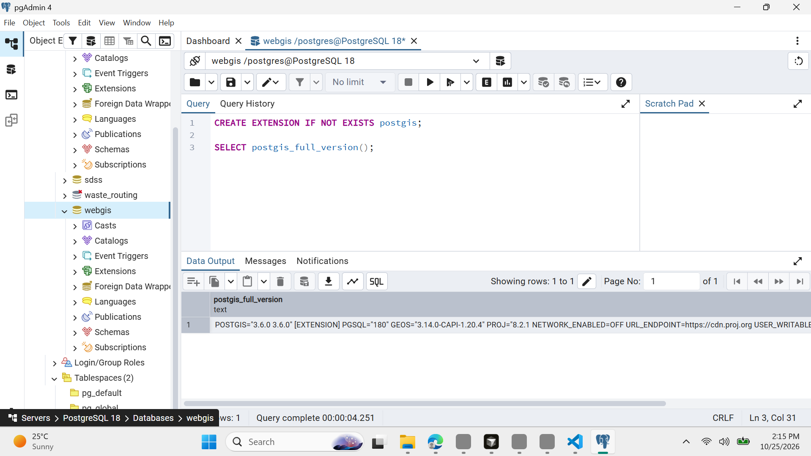

# Lab 4: Getting Started with GeoDjango

**Web GIS — Districts from PostGIS**

**Interactive Map (Local):** [Open Districts from PostGIS](http://127.0.0.1:8001/)

**GeoJSON API (Local):** [View District Data](http://127.0.0.1:8001/api/districts/)

---

## Checkpoint 1 — Django Setup and Versions

The Django project `webgis` and application `districts` were successfully created and verified in a Python virtual environment.

## Checkpoint 2 — PostgreSQL and PostGIS

PostgreSQL 18 and PostGIS 3.6.0 were configured. A PostGIS-enabled database named `webgis` was prepared to store spatial district data.

## Checkpoint 3 — Django Database Configuration

Django successfully connected to PostgreSQL/PostGIS, and the initial database migrations were completed. GDAL and GEOS library compatibility was verified.

## Checkpoint 4 — District Spatial Model

The `District` model stores district names, provinces, population, area and `MultiPolygon` geometries in EPSG:4326.

The database migration successfully created the spatial table `districts_district` and a GiST index on the geometry field for efficient spatial queries.

## Checkpoint 5 — Loading the District Data

The Pakistan district GeoJSON dataset was successfully imported into PostgreSQL/PostGIS.

A total of **160 districts** were loaded. Django ORM queries were used to verify the imported records and retrieve district information.

## Checkpoint 6 — Django Admin

The `District` model was registered in Django Admin to support authorized management of geographic information.

The screenshots demonstrate district filtering, record inspection and editing through the Django administration interface.

## Checkpoint 7 — Django GeoJSON API and Leaflet Map

The interactive Leaflet map displays **160 districts** retrieved directly from PostgreSQL/PostGIS through the Django API, rather than from a local static GeoJSON file.

Districts are symbolized using province-specific colours, and hovering over a district displays its name and province.

The Esri World Topographic Map was used as the basemap after the original OpenStreetMap tile service returned an HTTP 403 access restriction.

### Network Verification

| Property | Observed Result |
|---|---|
| API endpoint | `/api/districts/` |
| Request method | GET |
| HTTP status | 200 OK |
| Content type | `application/geo+json` |
| Content-Length | 1,026,495 bytes (approximately 1.03 MB) |

*Note: Content-Length represents the response-body size, which may differ from the transferred size reported by the browser's Network panel.*

## Checkpoint 8 — PostGIS Spatial Query (Bonus)

A spatial query was implemented to identify the district containing a user-selected location.

When a user clicks the map, latitude and longitude are sent to `/api/where/`. GeoDjango creates a geographic point and uses the `geom__contains` spatial lookup to identify the corresponding district.

The endpoint was tested successfully through Django.

### Area Comparison

| District | Stored Area (km²) | Geodesic Area (km²) | Web Mercator Area (km²) |
|---|---:|---:|---:|
| Lahore | 1,730 | 1,730 | 2,385 |
| Gilgit | 4,016 | 4,015 | 6,133 |
| Gwadar | 11,574 | 11,574 | 14,244 |

### Interpretation

Web Mercator is primarily intended for web-map visualization rather than accurate area measurement. The results demonstrate that Web Mercator produces larger area estimates compared with the stored and geodesic areas.

Area distortion generally increases toward higher latitudes. Therefore, geodesic calculations or locally appropriate projected coordinate systems are more suitable for accurate district area measurements.

---

## Software Versions

| Software | Verified Version |
|---|---|
| Python | 3.13.9 |
| Django | 6.1.2 |
| PostgreSQL | 18 |
| PostGIS | 3.6.0 |
| GDAL | 3.13.3 |
| GEOS | 3.15.0-CAPI-1.21.0 |

---

## Installation and Configuration Errors

During the installation and configuration process, several errors were encountered and successfully resolved.

### Error 1 — Python Launcher Not Recognized

**Error encountered:**

`py : The term 'py' is not recognized as the name of a cmdlet, function, script file, or operable program.`

**Cause:** The Windows Python launcher was unavailable.

**Solution:** The installed Python 3.13.9 interpreter was used directly through the `python` command.

**Verification:** Python and Django commands executed successfully within the virtual environment.

### Error 2 — GDAL Library Loading Error

**Error encountered:**

`OSError: [WinError 127] The specified procedure could not be found`

**Cause:** Django could not correctly load the required GDAL library and its dependent DLL files from OSGeo4W.

**Solution:** The OSGeo4W library paths were configured using `C:\OSGeo4W\bin`. The correct GDAL and GEOS DLL files were identified, and GDAL was preloaded before initializing GeoDjango.

**Verification:** GDAL 3.13.3 and GEOS 3.15.0 loaded successfully.

### Error 3 — PostgreSQL Authentication Failed

**Errors encountered:**

`FATAL: password authentication failed for user "postgres"`

`FATAL: fe_sendauth: no password supplied`

**Cause:** Django initially received an incorrect or missing PostgreSQL password.

**Solution:** The correct password was supplied through the `WEBGIS_DB_PASSWORD` environment variable in PowerShell instead of hardcoding it in `settings.py`.

**Verification:** PostgreSQL authentication was successful after correcting the credentials.

### Error 4 — PostgreSQL Database Not Found

**Error encountered:**

`django.db.utils.OperationalError: FATAL: database "webgis" does not exist`

**Cause:** The originally created PostgreSQL database had an additional trailing space in its name (`webgis `), whereas Django was configured to connect to `webgis`.

**Solution:** A correctly named `webgis` database was configured, the PostGIS extension was enabled, and Django migrations were executed again.

**Verification:** All required Django and spatial database tables were successfully created and displayed in pgAdmin.

### Error 5 — Django Template Not Found

**Error encountered:**

`TemplateDoesNotExist: districts/map.html`

**Cause:** The HTML template was initially stored in an incorrect directory.

**Solution:** The `map.html` file was placed in the correct template directory:

`districts/templates/districts/map.html`

**Verification:** The Django application successfully rendered the Leaflet web map.

### Error 6 — OpenStreetMap Basemap Access Blocked

**Error encountered:**

`HTTP 403 — Access blocked`

**Cause:** Requests to the OpenStreetMap tile server were blocked under its tile usage policy.

**Solution:** The Leaflet basemap was changed to Esri World Topographic Map.

**Verification:** The geographical basemap loaded correctly beneath the district polygons.

---

## Section 9.4 — Questions and Answers

### Question 1 — What can Django and PostGIS do instead of making visitors download an entire GeoJSON file? Give two examples.

A Django/PostGIS-backed application can perform filtering and spatial queries on the server and return only the requested results.

Two examples from this lab are:

1. **Province filtering:** `/api/districts/?province=Sindh` returns only districts belonging to Sindh.
2. **Spatial identification:** `/api/where/?lat=33.6423&lng=72.9906` identifies the district containing the specified geographic location.

This reduces unnecessary data transfer when users require only a subset of the district dataset or a specific query result.

### Question 2 — Why read the database password from an environment variable instead of placing it in `settings.py`?

An environment variable keeps the database password separate from the application's source code.

This reduces the risk of accidentally exposing sensitive credentials when uploading the Django project to GitHub. It also allows different computers and deployments to use their own database credentials without modifying the source code.

### Question 3 — What does the `USING GIST` index do, and which query benefits from it?

The GiST spatial index improves the performance of spatial queries by reducing the number of geometries that PostGIS must examine.

In this lab, the `geom__contains` lookup benefits from the GiST index when identifying which district contains a selected geographic point.

### Question 4 — Why does the loading script convert some Polygon geometries to MultiPolygon?

The Django model uses a `MultiPolygonField`, whereas the source GeoJSON may contain both `Polygon` and `MultiPolygon` geometries.

Converting single polygons to multipolygons ensures consistency with the database's expected geometry type and helps prevent geometry-type errors during data import.

### Question 5 — Who should and should not have Django Admin access?

Django Admin access should be restricted to authorized administrators, GIS specialists and designated data managers responsible for maintaining district records.

Ordinary public users should only access the interactive map and appropriate query endpoints. They should not have permission to modify or delete official geographic records.

### Question 6 — Where are the different latitude/longitude orders used, and how does the extension avoid confusion?

Leaflet uses coordinates in **[latitude, longitude]** order, as demonstrated by:

`setView([30.3753, 69.3451], 5)`

GeoDjango constructs geographic points using **(longitude, latitude)** order:

`Point(lng, lat, srid=4326)`

The extension avoids confusion by passing latitude and longitude as explicitly named URL parameters (`lat` and `lng`), which are read separately before constructing the geographic point in the correct order.

---

## Conclusion

Lab 4 successfully demonstrated the integration of Django, GeoDjango, PostgreSQL/PostGIS and Leaflet to develop a database-driven Web GIS application.

District boundaries and attributes were imported into a spatial database, managed through Django Admin, published through a GeoJSON API and visualized interactively using Leaflet.

The optional spatial-query extension further demonstrated server-side point-in-polygon identification and area calculations using PostGIS.